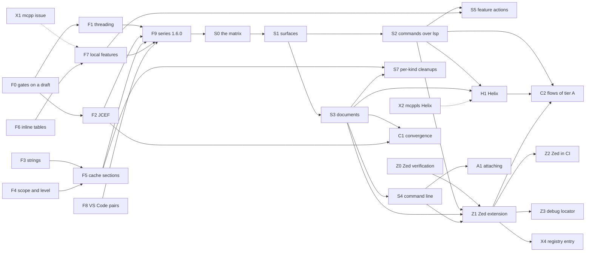

# Editor surfaces and the feature matrix: one rule for every plugin, with Zed and Helix

Status, 2026-11-21: accepted. Stream F (the fixes) is implemented in series 1.6.0; the section
"Stream F as implemented" records where the implementation differs from the plan. Streams S and E (the
surfaces, Zed and Helix) are not implemented and follow in pull requests of their own. The facts about
this repository were read from `main` (7c411fb) and from mcpp-ide 1.5.0 run over its protocol. The facts about Zed
and Helix come from their documentation and issue trackers and were not run; the section
"Unverified facts" lists them. The facts about mcppls were read from its repository at release
0.23.0.

## Scope

The record answers three questions raised by the issue review of 2026-11-21 (#12 and the CLion
reports of #13):

1. How Zed and Helix are supported, given that neither lets a plugin draw a panel.
2. How each plugin states, feature by feature, whether it reuses a shared implementation, implements
   the feature natively, or does not offer it.
3. How that statement is kept true by tooling and not by convention.

It also states how mcpp-ide stands beside mcppls, what the other repositories change, the fixes
and checked versions of the CLion plugin (#13), where each request for something on screen is
placed (#13, #15 to #18), and the plan of the work with its dependencies.

## The problem

The backend owns every decision, and three plugins map its answers onto their editors. That holds
for decisions. It does not yet hold for presentation, where four facts were observed:

| Observation | Where |
|---|---|
| Every `mcpp-ide/*` method needs plugin code to reach a user. An editor whose plugins cannot send a custom request reaches none of them. | Zed's extensions only name the server's command; Helix has no plugin system in a release. |
| The same view is rendered three times. The graph becomes mermaid text in `webui/src/graph.ts`, an indented list in the Neovim plugin's `graph_text`, and VS Code's own page. | `webui/`, `mide-plugins/nvim/lua/mcpp/views.lua` |
| A command's flow is repeated per plugin. A cleanup is planned, confirmed at its danger level and applied in `Dispatch.kt`, in `commands.lua` and in the extension. The sequence is a decision; only the dialog is presentation. | the three plugins |
| What an editor does not offer is recorded for commands only (`omitted` in `spec/commands.json`). For views, tests, debugging and status there is no record, and a missing surface at run time is a crash. | #13: the graph page without the JCEF plugin |

The backend also branches on editor names (`spec::offered_in`, `vscodeArguments`), and a client that
names no editor is treated as VS Code. The project's rule for mcpp is "capabilities, not versions".
The same rule is not yet applied to editors.

## The model

### Surfaces

A surface is one way a feature reaches a user. There are seven. Five are implemented once, outside
the plugins.

| Surface | What it is | Implemented in | Plugin code |
|---|---|---|---|
| `native` | the host's own component over an `mcpp-ide/*` view model: a tree, a form, a test explorer, a debugger session | each plugin | yes |
| `webui` | a page of `webui/` in a web view the host provides | `webui/`, once | a host for the page |
| `lsp` | standard LSP: completion, hover, definition, symbols, diagnostics, code actions, code lenses, `workspace/executeCommand`, `$/progress`, `window/showMessageRequest`, `workspace/applyEdit`, `workspace/configuration` | the backend, once | none |
| `document` | a view the backend renders to a file (Markdown, Mermaid in Markdown, plain text) and opens with `window/showDocument` | the backend, once | none |
| `task` | the backend's one-shot command line in the host's terminal or task runner | the backend, once | a declaration at most |
| `host` | the editor or another extension provides it; this project provides nothing (bracket pairing by the host's TOML language, C++ features by mcppls) | -- | none |
| `omitted` | not offered, with a reason and the party that could change it | -- | none |

### Rules

1. **One implementation per surface.** `lsp`, `document`, `task` and `webui` are written once. A
   plugin writes only `native` code and the host of a `webui` page.
2. **Native is justified, not assumed.** A plugin implements a feature natively when its host has
   the API and the native component gives an interaction the shared surfaces cannot: a tree with
   actions, a test explorer, a debugger, a terminal. Otherwise it reuses.
3. **Every cell is stated.** For each feature and each editor exactly one surface holds. `omitted`
   carries a reason and names the party (the editor's API, an upstream issue, this project's plan).
   An empty cell fails CI.
4. **Native is declared, the rest is resolved.** A `native` or `webui` cell means code in that
   plugin, so the editor's row declares it, with what it falls to (`clion: ["webui", "native"]` for
   a graph). For every other cell a feature lists the shared surfaces that can deliver it, best
   first, an editor lists the shared surfaces its host has, and the cell is the first match. Where
   nothing matches, an `omitted` reason is required.
5. **Resolution continues at run time.** The client states its surfaces at `initialize`. When a
   surface is absent in a running editor (the JCEF plugin disabled, `showDocument` unsupported), the
   next surface is used. When none remains, `capabilities/explain` answers the feature with
   `source: "editor"`, as it answers `source: "mcpp"` today.
6. **No editor name in a decision.** `editor` identifies the client for strings, icons and reports.
   Behaviour follows the stated surfaces. A client that names no editor is the profile `lsp`. Data
   frozen by parity (`vscodeArguments`, the deprecated ids) may be keyed by VS Code's identity; it
   is data of 0.9.0, not a decision.
7. **A flow is the backend's.** Over `lsp`, `workspace/executeCommand` runs the whole flow and asks
   the client through standard requests. A command that requires acknowledgement is offered only to
   a client that can ask for it.
8. **VS Code's pages stay frozen.** Parity with 0.9.0 holds for the existing pages. A new feature
   reaches VS Code through `lsp` or a native component (a QuickPick), not through a changed page.

### Editor tiers

| Tier | Editors | The plugin is | Speaks |
|---|---|---|---|
| A, hosted plugin | VS Code, CLion, Neovim | code over the host's UI API | `mcpp-ide/*` and LSP |
| B, declarative extension | Zed | declarations: the server's command, tasks, a debug locator | LSP only |
| C, configuration | Helix; any LSP client (Emacs eglot, Sublime LSP, Kate) | a configuration snippet | LSP only |
| -- | agents and scripts (`editor: "cli"`) | none | `mcpp-ide/*` |

Tiers B and C rest on the same backend work. Supporting both costs one backend change and two small
directories, which is why the answer to "Zed and Helix, both" is yes.

## Two language servers, side by side

### The present arrangement

An editor in an mcpp project speaks to two servers, and neither passes through the other.

| | mcppls | mcpp-ide |
|---|---|---|
| Serves | every C and C++ file | `mcpp.toml`, and the rules of `build.mcpp` |
| Reaches the editor through | its own integration (mcppls's `editors/`: VS Code, CLion, Neovim, Zed, agents) | this repository's plugins |
| Runs without the other | yes; it needs no mcpp-ide and no mcpp project | yes; without mcppls the C++ features are the editor's own |

The backend is not on the path of a C++ request. What it knows of mcppls it reads out of band:
`mcppls --version`, `mcppls status --format json`, the payload's `payload.json`. Both read mcpp's
result record, so a build refreshes mcppls with nothing forwarded. `build.mcpp` is the one file
both answer; the plugin tells the backend whether mcppls serves it (`mcpplsServes`), and the backend
then leaves it what a compiler answers better.

### The alternatives

| Arrangement | Effect | Verdict |
|---|---|---|
| Peers, as now | each product stands alone; the editor merges two servers, which VS Code, Neovim, Zed and Helix all do, and CLion does through its plugin | kept |
| mcpp-ide in front of mcppls, one server to the editor | every C++ keystroke crosses the backend; the backend must pass on every LSP feature mcppls has or gains; a fault of one stops both; the two versions bind | rejected: it contradicts "mcppls: every language feature of C++ files" and mcppls's independence |
| mcppls answers `mcpp.toml` too | mcppls would take the rules of mcpp's files and a dependency on an mcpp project | rejected: mcppls serves projects of any build tool |
| One editor extension that starts both | a second copy of mcppls's integration, in step with neither repository | rejected |

### The rule

The two servers are peers that meet in data, never on a wire: mcpp's result record, `mcppls
status`, and what each states of itself. Three consequences follow.

1. **Each repository owns its integrations.** An editor has an mcppls integration and an mcpp-ide
   integration. Neither carries, starts or proxies the other's server. The row "C and C++ language
   features" of the matrix is `host` in every column.
2. **`build.mcpp` is divided once.** The backend answers the rules a compiler cannot (the diagnostics
   of SPEC-007, the directives' snippets) and leaves the rest when mcppls serves. A client of tier B
   or C has no plugin to say so; there `mcpplsServes` is a setting whose default is what the backend
   itself finds (`languageService/status` is `ok`).
3. **mcppls's commands stay mcppls's.** The `forward` rows of `spec/commands.json` exist for VS
   Code's manifest of 0.9.0 and are not extended to another editor. Elsewhere mcppls's actions are
   reached through mcppls's own integration; the backend shows its state and what to install.

A missing mcppls is already a check of `initialize` (`languageService`). Over `lsp` it becomes one
`window/showMessage` naming mcppls's integration for that editor, since Zed and Helix have no
dependency between extensions.

## The feature matrix

### The source

A new file, `spec/editors.json`, holds three lists. The backend embeds it, as it embeds the rest of
`spec/`.

```json
{
  "surfaces": ["native", "webui", "lsp", "document", "task", "host"],
  "editors": {
    "zed":   { "tier": "B", "has": ["lsp", "document", "task"], "documentFormats": ["mermaid", "markdown", "text"], "evidence": "compiled" },
    "helix": { "tier": "C", "has": ["lsp", "document"], "documentFormats": ["text"], "evidence": "declared" }
  },
  "features": [
    { "id": "graph.packages",
      "shared": ["document"],
      "declared": { "vscode": ["native"], "jetbrains": ["webui", "native"] },
      "omitted": {} },
    { "id": "status",
      "shared": [],
      "declared": { "vscode": ["native"], "jetbrains": ["native"], "nvim": ["native"] },
      "omitted": { "zed": { "party": "editor", "reason": "Zed's extensions add no status item; a job's progress is LSP's." } } }
  ]
}
```

`evidence` is the strength of the claim, in the three tiers of the documentation style: `e2e` (run
in CI inside the editor), `compiled` (the package builds and its declarations are checked),
`declared` (checked against the LSP conformance suite only).

### What is generated and checked

| Tool | Does |
|---|---|
| `mcpp-ide-dev check-editors` | resolves every cell; fails on an empty cell, an unknown surface, an `omitted` without party and reason, or a command whose feature no editor resolves |
| `mcpp-ide-dev gen docs` | writes the matrix into `docs/editors.md` and the editors table of both READMEs; CI expects no diff |
| each plugin's test | the surfaces the plugin sends at `initialize` equal its row in the spec |
| `capabilities/explain` | answers every feature for the connected client with its surface, or the reason it has none |

`spec/commands.json` gains `feature` on each command. `editors` and `omitted` there are then derived
and removed, after one series in which both are checked to agree.

### Initial content

The cells below are the proposal. The columns of the three existing plugins follow
`docs/architecture.md` and their sources; implementation fills each from the code and corrects this
table where they differ. Parentheses name the component.

| Feature | VS Code | CLion | Neovim | Zed | Helix |
|---|---|---|---|---|---|
| `mcpp.toml` completion, hover, jumps, diagnostics | `lsp` | `native` (the platform's LSP client would start a second server) | `lsp` | `lsp` | `lsp` |
| `build.mcpp` rules | `lsp` | `native` | `lsp` | `omitted` at first: see the review | `omitted` at first |
| Pairs and comments in `mcpp.toml` | `native` (language configuration, to add) | `host` | `host` | `host` | `host` |
| The command table | `native` (palette, menus) | `native` (actions) | `native` (`:Mcpp`) | `lsp` (code actions, code lenses) | `lsp` (code actions, `:lsp-workspace-command`) |
| Build, test and cleanup jobs | `native` (pseudoterminal, Problems) | `native` (console) | `native` (buffer) | `lsp` (progress, diagnostics) | `lsp` |
| Running the program | `native` (terminal) | `native` (run configuration) | `native` (terminal) | `task` | `omitted`: no terminal; the command line runs it outside |
| Debugging | `native` | `native` | `native` (nvim-dap) | `native` (debug locator), after verification | `omitted`: static DAP templates |
| Test tree | `native` (Testing) | `native` | `native` | `omitted`: no test API; results are diagnostics | `omitted`: same |
| Test insights | `native` (page) | `webui` | `document` | `document` | `document` |
| Project view | `native` (tree) | `native` (tree) | `document` | `document` | `document` |
| Targets, toolchains | `native` | `native` | `native` (`vim.ui.select`) | `lsp` (message request) | `lsp`, or settings |
| Libraries | `native` (page) | `native` | `native` | `lsp` (dependency completion) | `lsp` |
| Cache inventory | `native` (page) | `native` (tree) | `document` | `document` | `document` |
| Dependency and module graphs | `native` (page) | `webui`, then `native` (a tree) | `document` (text) | `document` (Mermaid) | `document` (text) |
| Pack | `native` | `native` | `native` | `omitted` in the first release | `omitted` |
| Settings | `native` | `native` (generated form) | `native` (`setup()`) | `lsp` (`workspace/configuration`) | `lsp` (`config`) |
| Status item | `native` | `native` | `native` (statusline) | `omitted`: no API | `omitted`: no API |
| Self-check, report | `native` | `native` | `native` | `document` | `document` |
| mcppls's own commands | `native` (forward) | `omitted` | `omitted` | `omitted` | `omitted` |
| C and C++ language features | `host` (mcppls) | `host` (mcppls) | `host` (mcppls) | `host` (mcppls) | `host` (mcppls, once it has a fragment) |

Two cells change an existing plugin. CLion's graph falls to a native tree when JCEF is absent, which
is rule 5 applied to #13. Neovim's views become the backend's text, which removes `graph_text`,
`cache_text` and `targets_text` from the plugin.

## The backend's part

### The `lsp` profile

- `initialize` reads the client's LSP capabilities: `window.showDocument`, `window.workDoneProgress`,
  `window.showMessage.messageActionItem`, `workspace.applyEdit`, `workspace.configuration`,
  `textDocument.codeAction`, `textDocument.codeLens`. They become the session's surfaces. A plugin of
  tier A adds its own in `initializationOptions.surfaces`.
- The server states `executeCommandProvider` (the command table's ids resolved for the client),
  `codeActionProvider` and `codeLensProvider` only to a client whose commands resolve to `lsp`. A
  plugin of tier A is answered as today: VS Code's and Neovim's language clients show whatever a
  server advertises, and would otherwise gain a second set of commands beside their own.
- The additions are standard LSP methods and new fields. The protocol stays 2, and
  `protocol/protocol.schema.json` and the method list gain them together.
- A code action is the canonical way to a command, since every LSP client has it. A code lens is an
  addition: Zed has it behind a setting, Helix does not. On `mcpp.toml`, `[package]` offers build,
  test and clean; `[targets.<name>]` offers build and run of that target; `[dependencies]` offers the
  graphs.
- `workspace/executeCommand` runs a command as the plugins' dispatchers do today. A job reports
  through `$/progress`, its narration through `window/logMessage`, its diagnostics through
  `textDocument/publishDiagnostics` on the files they name. A confirmation is a
  `window/showMessageRequest` whose actions are the plan's.
- Settings arrive through `workspace/configuration` (section `mcpp`) and
  `workspace/didChangeConfiguration`, and pass the validation that exists.
- The language is LSP's `locale`. Titles of actions are the backend's strings, as now.

### The `document` surface

- `views.cppm` gains renderers beside the view models: `text`, `markdown` and `mermaid`. The
  flowchart that `webui/src/graph.ts` builds moves here, so the page, Neovim, Zed and an agent read
  one text. `graph/packages` and `graph/modules` accept `format`.
- A document is a file in the backend's own state directory, keyed by project, never in `target/`,
  which is mcpp's. It is rewritten when its view changes (`result/changed`, `manifest/changed`).
- A module's node links to its source by path, so the host's own link handling opens it.
- A document is a view. Its actions stay on `mcpp.toml`, where code actions exist.

### The `task` surface

`mcpp-ide job <kind> [--root] [--target] [--profile]` runs one job on the session's code path and
writes the narration to standard output. `mcpp-ide view <id> --format <f>` prints a document.
`mcpp-ide launch --format json` prints the launch a debugger needs.

### A command line beside a session

A task is a process of its own. Beside an editor's session it differs from that session in four
ways, of which the settings are only the visible one.

| What the session holds | A separate process |
|---|---|
| the settings a job runs with (`mcpp.path`, `mcpp.build.profile`, `mcpp.build.target`, `mcpp.task.*Args`, `mcpp.trust.denyEffects`, `mcpp.runtime.*`) | takes flags, so two builds of one project can differ |
| the project's lane: one job at a time, a newer one replacing a waiting one | runs beside the lane |
| the job's diagnostics, published to the editor | prints them; Zed's tasks have no problem matcher, so they never reach the editor |
| cancellation and the views that follow a job | none; the views follow only through mcpp's result record |

Four arrangements were weighed for the long term.

| Arrangement | Verdict |
|---|---|
| Flags only | the first release. It is the divergence itself. |
| A settings file of the backend's in the project | refused. Tier A's editors have settings of their own, so the file is a second source with a precedence to define, and it mends the first row only. |
| The settings in mcpp's own configuration | right for what is the project's and mcpp already reads (`[build] default-profile`): every route, a terminal included, then agrees with no work here. Not for a user's current choice of target, which is not the project's to commit; and mcpp is not changed. |
| The command line attaches to the project's running session | the long-term arrangement. |

**Attaching.** A session is the one holder of a project's job state, and a command line is one more
client of it. `mcpp-ide job` looks for a running session of the project. When it finds one it asks
that session to run the job and prints the narration the session streams back. When it finds none
it runs alone, with flags and the defaults, as `editor: "cli"` does today. All four rows above then
hold: the settings and the selected target are the session's, the job waits in the project's lane,
its diagnostics appear in the editor, and it can be cancelled from either side.

The same arrangement serves an agent working beside an editor (its build is seen in the editor and
does not run over the user's) and a terminal inside Neovim. It is therefore not a feature of Zed.

What it needs, and why it is not in the first release:

- An endpoint. The session listens on the loopback interface (`mcpplibs.os` 0.4.2 has a loopback
  listener) and writes a record in the backend's state directory: the project's root, the process,
  the port, a token, the series. The file is the user's alone and the token is required. A record
  whose process has ended is ignored and removed.
- The series rule. A command line of another series is refused, as a plugin is.
- Several sessions of one project (two editors open). The newest is taken unless one is named.
- Trust. An attached job runs with the session's trust and its denied effects.
- More than one connection per session. Today a session has one connection, and every notification
  goes to it. A job's events must go to the connection that started the job and to the editor's.
  This is the cost, and it is the backend's to design in a record of its own.

Until then the first release keeps the divergence small: the generated tasks pass no option, so a
task and a code action differ only when a user has set a job setting, and the README of each tier B
and C editor says that job settings apply to commands started in the editor.

## The two new adapters

### Helix, tier C

`mide-plugins/helix/` holds a `languages.toml` fragment and a README. Nothing else exists to write:
by the upstream pull request (helix#8675, labelled experimental in October 2026) no release has a
plugin system.

```toml
[language-server.mcpp-ide]
command = "mcpp-ide"
args = ["serve"]
required-root-patterns = ["mcpp.toml"]
config = { editor = "helix" }

[[language]]
name = "toml"
language-servers = ["taplo", "mcpp-ide"]
```

The backend is attached to the host's TOML language and answers only `mcpp.toml`; other documents
are of kind `other` and get nothing, as today. No grammar and no query files are shipped, and
pairing and comments are the host's. Commands are code actions and `:lsp-workspace-command`. A
graph is the text document. Running and debugging are `omitted`.

The C++ entry is not this fragment's. Which files are C++ (`build.mcpp`, `.cppm`) and which server
answers them first is mcppls's to state, in a fragment of its own (section "Work across
repositories"). The backend is not attached to C++ in the first release (section "Review of this
record", finding 2).

### Zed, tier B

`mide-plugins/zed/` is an extension: `extension.toml`, a Rust crate compiled to WebAssembly, tasks
generated by `mcpp-ide-dev gen zed`, a debug locator. It follows mcppls's Zed extension
(`editors/zed` there, released as 0.23.0), which is the same kind of thing and already passes a run
in a real Zed in that repository's CI.

- The crate answers the server's command: `mcpp-ide` on `PATH` (xlings), else the backend of the
  extension's own series, downloaded from the release. It declines when the worktree has no
  `mcpp.toml`, so the backend starts only in an mcpp project.
- The server is declared for the host's TOML language. C++ follows later (section "Review of this
  record", finding 2); an extension cannot add a suffix to a language Zed defines (mcppls's README),
  so `build.mcpp` is C++ only with the user's `"file_types": { "C++": ["mcpp"] }`.
- Tasks are the first way to build, run and test in Zed: they are in the task picker from any file.
  Code actions exist only in `mcpp.toml`, and code lenses are off by default.
- Tasks call `mcpp-ide job`. A task that called `mcpp build` directly would skip the profile, the
  target and the denied effects, which are the backend's decisions.
- A graph is Mermaid in Markdown, which Zed's preview renders (stable 0.225.9 and later).
- The debug locator turns the run task into a scenario of Zed's own adapters from
  `mcpp-ide launch`.
- A context server for Zed's agent is a later addition over the same backend as `agents/`.

### Versions and release

Zed's `extension.toml` becomes a seventh statement of the version, with the tag `zed-vX.Y.Z`. The
Helix fragment states no version; it starts the `mcpp-ide` on `PATH` and is released with the
series. `components.tsv` gains `zed` and `helix`. `spec/editors.json` is a backend path, so its
introduction begins a series.

## Work across repositories

### The parties

| Repository | Owns here | Changes for this design |
|---|---|---|
| mcpp | the machine contract | none for Zed and Helix; one request, a package's features |
| mcppls (`Sunrisepeak/mcpp-language-server`) | C and C++ in every editor; its `editors/` | a Helix fragment, `editors/helix`; nothing else |
| mcpp-ide | the project layer; `mide-plugins/` | everything in this record |
| the xlings index | the packages `mcpp-ide`, `mcpp-ide-nvim` | none: Helix and Zed start the `mcpp-ide` package |
| `zed-industries/extensions` | Zed's registry | one entry, pointing at `mide-plugins/zed` |

### mcppls and Helix

mcppls is a standard LSP server, so Helix needs from it what it needs from mcpp-ide: a fragment and
a README, as mcppls already ships configuration fragments for other clients. It belongs in mcppls's
repository by the rule above. It is worth doing for its own sake: without it a Helix user's C++ is
clangd with no module database, whatever mcpp-ide does.

### The points where the two repositories must agree

No code is shared and no release waits for the other. Four statements must be the same in both.

| Statement | Owner | The other repository |
|---|---|---|
| The servers' names in an editor's configuration: `mcppls`, `mcpp-ide` | each its own | uses the name as given |
| The C and C++ language entry of an editor: its file types (`build.mcpp`, `.cppm`), the order of its servers, clangd off | mcppls | adds one server to the list; never restates the entry |
| The TOML language entry | mcpp-ide | -- |
| The division of `build.mcpp` | mcpp-ide's `docs/rules.md` | mcppls links to it |

Helix makes the second row necessary: a language's `language-servers` is one list, and two
fragments that each set it overwrite one another. Each README therefore shows its own
`[language-server.<name>]` table, which merges, and the same combined `[[language]]` line with the
other server marked optional.

### The order

1. mcpp-ide phases 0 and 1 need nothing from mcppls.
2. mcppls's Helix fragment and mcpp-ide's (phase 2) are independent. Each README links the other
   when the other exists.
3. mcpp-ide's Zed extension (phase 3) is written beside mcppls's and reuses its approach to
   installing and to testing in a real Zed.
4. One tracking issue in mcpp-ide lists the linked issues of the other repositories. A pin names
   only a released version, as AGENTS.md states.

## CLion: the fixes of #13 and the versions it is checked on

### The fixes

Four defects of mcpp-clion 1.5.0 were confirmed in the source. Each is the plugin's and is fixed
there. They are part of the one pull request of fixes (section "The fixes as one pull request per
repository") and do not wait for the surfaces.

| Defect | Cause | Fix | Rule it becomes |
|---|---|---|---|
| "Read access is allowed from inside read-action only", at startup and on the backend's start | `McppDocuments.reopen()` reads documents from the startup coroutine and from the thread that reads the backend's output | the reading thread decodes frames and completes futures; listeners run on an executor; `reopen()` takes its snapshot in a read action | the reading thread runs no listener |
| `NoClassDefFoundError: JBCefApp` on opening a graph | the dependency on `com.intellij.modules.jcef` is optional, and `JcefPage`, a class of the core, links to JCEF's classes. The existing guard, `JBCefApp.isSupported()`, is the call that fails. | a page-host interface in the core; its JCEF implementation registered only in `mcpp-jcef.xml`; no JCEF import outside that package | rule 5: an absent surface resolves to the next |
| A tooltip in English beside Chinese rows | the toolbar's texts are read once at construction, before `i18n/bundle` arrives; the translations exist | texts are set when presented (`update()`), tab titles again when the session starts | a string is read when shown |
| Seven identical buttons on the cache tab | the tab lacks the two sections VS Code's page has, and draws every command as one icon in a toolbar | the sections Project and Shared cache, each with its actions (section "The interface") | an action sits on what it acts on |

The issue's own proposals for the second and third are not taken: the dependency is already
declared and the guard already present, and an IntelliJ resource bundle would move strings out of
the backend.

### The versions

| | Now | Gap shown by #13 |
|---|---|---|
| Installs on | build 261 and later, no upper bound | -- |
| Built against | 2026.2.3 (`platformVersion`) | -- |
| Verified statically | 2026.1 and 2026.2.3 | -- |
| Run in a real IDE | 2026.1.5.2 and 2026.2.4.1, on Linux x86_64 only | the report is from macOS aarch64; JCEF is a bundled plugin built per system and architecture |
| Without JCEF | `ide.browser.jcef.enabled=false`: JCEF present and switched off | the JCEF plugin absent or disabled was never run |
| Errors the IDE logs | not a failure | both threading errors are logged, not thrown, so the runs passed |
| mcppls plugin | 0.21.0 (`mcpplsPluginVersion`) | mcppls is at 0.23.0 |

The proposal:

1. **The real-IDE run fails on any error the IDE logs from this plugin.** This one gate would have
   caught both threading paths, and catches the next of their kind.
2. **A run with the JCEF plugin disabled** (`disabled_plugins.txt`) beside the run with JCEF switched
   off.
3. **A run on macOS aarch64** of the newest stable CLion, at least for the startup chain and the
   graph. Whether a stock 2026.2.4 on macOS gives a plugin JCEF is not known; this run answers it,
   and the answer decides whether the defect reaches every macOS user or one installation.
4. **Three versions are named and moved together**: the oldest claimed (2026.1), the one built
   against, and the newest stable, which the real-IDE run uses. A scheduled job runs the verifier
   and the real-IDE run on the newest stable release, so a new CLion is met by CI before by a user.
5. **`mcpplsPluginVersion` follows mcppls's releases**, as a pin of a released version.

## The interface

### The principles

A change on screen is placed by five statements. They hold for the changes below and for later ones.

1. **One information structure, each host's components.** A view model is a list of sections; a
   section has a title, its measures, its rows and its actions. VS Code's page draws a section as a
   block, CLion as a top-level node of a tree, Neovim and the `document` surface as a heading. What
   is shared is the structure and its order, not a widget.
2. **VS Code's pages are the reference structure.** They exist, are frozen by parity and were
   designed as pages. A view in another editor that orders the same facts differently is the one
   that changes.
3. **An action sits on what it acts on.** An action of a section is drawn with that section. A
   toolbar holds only what acts on the whole view (refresh).
4. **No colour of this project's own.** Text, icons and emphasis are the host's: the theme's
   variables in VS Code, `SimpleTextAttributes` and `AllIcons` in CLion, highlight groups in Neovim,
   the host's theme in a Mermaid document. Kinds of things differ by shape, stroke, icon or a word
   (`webui/graph.ts` already marks an external node by a dashed stroke and a test by a thick one),
   so a view reads the same in a light theme, a dark theme and plain text.
5. **Danger is a confirmation, not a colour.** The plan's level decides the confirmation: none,
   a modal with the preview, a second acknowledgement. A button is not painted red in any editor;
   VS Code's page does not, and a coloured border is no IntelliJ component.

What is reused, by kind:

| Reused | Where it lives | Used by |
|---|---|---|
| the structure (sections, their order, their actions) | the backend's view model | every editor |
| the text of a view (`text`, `markdown`, `mermaid`) | the backend's renderers | Neovim, Zed, Helix, agents |
| a page | `webui/` | CLion's JCEF host; a browser |
| a tree of sections | one component per plugin (`Row`, `RowNode`, `RowRenderer` in CLion) | every tab of that plugin |
| the strings | `spec/i18n` | every editor |

### The cache view (#13)

VS Code's page has two blocks, and its six actions sit in them under their titles:

| Block | Measures | Actions |
|---|---|---|
| Project (`target/`) | its size | Clean stale, Clean project |
| Shared cache | size and entries; composition by kind; by last use; the largest | Verify, Collect to a budget, Prune, Remove the legacy cache (when one exists) |

CLion's tab has the shared cache's rows only, flat, and every action as one icon in a toolbar. The
report (seven identical buttons, no grouping) is the absence of this structure. The tab takes it:

```text
[Refresh]
v Project                      target/                    Clean stale...   Clean project...
v Shared cache                 3.4 GiB in 212 entries     Verify   Collect...   Prune...
    v By kind
        pkg                    2.1 GiB · 150 entries
        std                    1.3 GiB · 2 entries
    > Largest
    > By last use
    ! 3 incomplete entries
> Legacy cache                 <its path>                 Remove...
```

- **Placement.** The toolbar keeps Refresh. A section's actions are that node's: links at the right
  of its row, and the same entries in its context menu and on the keyboard. An ellipsis marks an
  action that asks before it acts.
- **What the backend adds.** `commands/list` gives a cache command its `scope` (`project` or
  `shared`, the plan's `group`) and its `level`. The plugin places a command by its scope and
  invents no grouping. Two commands with one plan (`mcpp.clean`, `mcpp.cleanProjectArtifacts`) are
  one action in the view.
- **The palette.** The commands stay in the palette and the menus as they are; the view's actions
  are the same commands (decided 2026-11-21: both stand).
- **Colour.** None. The warning icon stays on the incomplete entries, where it reports a state.
- **Other editors.** Neovim's cache text and the cache document take the same two headings; over
  `lsp` the actions are code actions.

Three requests of the report are answered by this and need nothing more: grouping, in-place
actions, and labels. Its remaining requests:

| Request | Disposition |
|---|---|
| Clean one kind from its row (`pkg`, `std`) | taken as a feature of every editor, after the fixes (decided 2026-11-21; task S7 of the plan). The plans exist (`cacheDeps`, `cacheStd`) and no editor offers them. Two commands join the command table; the rows `pkg` and `std` carry them in CLion, in Neovim's text and in the cache document. In VS Code they are in the palette and in the context menu of the sidebar's cache tree, which parity admits (it forbids changing or dropping what 0.9.0 contributed, not adding); the page is unchanged. |
| Highlight what a button affects | not taken: an action on its own section needs none |
| Confirm with the size to be freed | present: `cache/plan` gives the level and the preview |
| Red for dangerous actions | not taken: principle 5 |

### Strings (#13)

A tooltip in English is a text read before the bundle arrived, fixed in the plugin. An IntelliJ
resource bundle and a lint for hard-coded strings are not taken: the strings are the backend's, and
`check-i18n` already holds English and Chinese together.

### A dependency's features (#16, #17)

mcpp is not changed from here. A request is made of mcpp (an issue there, decided 2026-11-21), and
what it would enable is not built until mcpp states it. mcpp states no features of an index package:
`mcpp search --format json` and `mcpp xpkg parse --format json` were run on a package that declares
one (`compat.harfbuzz`, `no-freetype`) and neither answer names it. Reading the index's descriptors
from disk is excluded by "Only mcpp's contract". What can be answered is what the text of a
manifest shows, which is the rules layer's own ground:

| Dependency | Its features are read from | Offered |
|---|---|---|
| given by `path`, or a workspace member | that manifest's `[features]`, which the rules layer already opens for the jump from `path = "../x"` | completion in `features = [...]`, hover, the diagnostic `mcpp.manifest.unknownFeature`, code actions "Enable feature" and "Disable feature" |
| the project's own `[features]` | the open document | as today (the jump to `[features.<name>]`) |
| from an index | nothing mcpp states | nothing yet; `capabilities/explain` says that mcpp states no features of an index package and names the issue that asks for it, as it names mcpp#917 for the tests |

- **Placement.** In `mcpp.toml`, on the dependency, where the array is written. No panel, no page
  and no sidebar entry changes. It is on `lsp`, so the five editors have it alike with no plugin code.
- **Layout.** A hover lists each feature on a line: its name, "default" as a word when it is one,
  and the names it implies. A manifest has no description of a feature, so none is shown.
- **The checkboxes the issues ask for** are kept as a design and not built: a section "Features" in
  a package's detail, under its description, one checkbox with name and description per feature,
  "default" as a word. They need an index package's features and wait until mcpp states them.

The larger part of what #16 and #17 ask, index packages, is answered when mcpp states them. The
request asks for each feature's name, whether it is a default, what it implies and a description,
by package and version, in a JSON query, with a name in `features` for the capability. The user
documentation notes the limit: features are completed for `path` and workspace dependencies.

### Editing `mcpp.toml` (#15, #18)

| Request | Disposition |
|---|---|
| Quotes and brackets close | VS Code's language configuration for `mcpp-toml`, which also gives `#` comments and bracket matching; `host` elsewhere |
| Keys inside `{ }` | one rule of the rules layer: an inline table at a key is read as the table of that name |
| Values of `kind` | present in 1.5.0 |
| Completion that takes seconds | not reproduced: 1.3 ms in the backend. The report's version and log are needed. |
| Ctrl+X | not this project's: the extension binds no such key |

### Graphs (#12, #13)

A graph in CLion without JCEF, in Zed and in Helix is one request, a graph where no web view
exists, with one answer by principle 1. The view model is one section per package with the packages
it depends on as rows. CLion draws it as a tree in the graph's own tab, with the tab's other
component and no new place; Zed reads it as Mermaid; Helix and Neovim as text.

## The fixes as one pull request per repository

The fixes are made together and land as one pull request in each repository. AGENTS.md asks that a
pull request do one thing; here the one thing is the fixes of the review of 2026-11-21, and each
fix is a commit of its own so that the squash message lists them.

| Repository | The pull request | Contains |
|---|---|---|
| mcpp-ide | `fix/issue-review-2026-11-21`, series 1.6.0 | CLion: the four fixes, the cache tab's sections, the added runs. VS Code: the language configuration and the parity gate. Backend: inline tables in the rules layer, features of `path` and workspace dependencies, `scope` and `level` on cache commands. CHANGELOG and the affected docs. |
| mcppls | one, in its repository | the Helix fragment |
| mcpp | an issue | a package's features in a JSON query. Nothing here waits for it. |

The surfaces (phases 0 to 4) are not fixes and follow in pull requests of their own.

A draft pull request is the place for what cannot be run on a developer's machine. Three uses are
foreseen, each closed or converted when it has answered:

1. The added CLion runs first, without the fixes, to see them fail on the defects: the logged-error
   gate, the JCEF plugin disabled, macOS aarch64. The last answers the open fact about JCEF on macOS.
2. The fixes on top, until the same runs pass.
3. The verifications of Zed and Helix, with a scripted client and a real Zed in CI.

Opening one is an outward action and is asked for each time, as AGENTS.md states.

## Tests

| Layer | Test |
|---|---|
| The `lsp` surface | `tests/cts/lsp`: a scripted client in two profiles, minimal (Helix's capabilities) and full (Zed's), with golden answers for code actions, a command's flow, progress, a confirmation and a refused command |
| The `document` surface | goldens of each view in each format over `protocol/fixtures` |
| The matrix | `check-editors`; each plugin's surfaces against its row |
| Zed | the crate builds to WebAssembly in CI; the generated tasks show no diff; evidence `compiled`, then `e2e` with a run in a real Zed as mcppls's CI has |
| Helix | the fragment parses; evidence `declared` until an end-to-end run exists |
| CLion | the runs of the section on CLion: no logged error, the JCEF plugin disabled, macOS aarch64 |

## Phases

| Phase | Content | Reaches |
|---|---|---|
| F | The fixes, one pull request in this repository, series 1.6.0. Independent of the phases below. | #13, #15, #18 |
| 0 | `spec/editors.json`, `check-editors`, the generated table, for the three plugins and `cli` as they are. No behaviour changes. | the record exists and is checked |
| 1 | The `lsp` profile, the `document` surface with the graphs first, `mcpp-ide job` and `view` | every LSP client; agents |
| 2 | Helix: the fragment and its README | the cheapest proof of phase 1 |
| 3 | Zed: the extension, the tasks, then the locator | the Zed extension registry |
| 4 | Convergence of tier A where it removes code: Neovim's texts, CLion's graph fallback, the page's flowchart, the dispatchers' flows | less plugin code |
| 5 | A command line that attaches to the running session, after a record of its own | tasks, agents and terminals share the session's settings, lane and diagnostics |

Phase F is a series of its own, since it changes the backend. Phases 0 and 1 are the next series.
Phase 2 precedes phase 3 because it validates the backend work with no packaging. Zed's
verification can run beside phase 0. The section "The plan of the work" divides the phases into
tasks.

## Where the reviewed issues meet this design

| Issue | Meeting point |
|---|---|
| #13, the CLion plugin | the section on CLion: four fixes, and the runs that would have caught them |
| #13, `std.pcm` overwritten | not this project's: mcpp writes the compilation database. No workaround, and no report from here (decided 2026-11-21). |
| #15 and #18, pairs in `mcpp.toml` | the matrix row "Pairs and comments": `native` in VS Code only. Decided 2026-11-21: the parity gate keeps every field of 0.9.0's `languages` and admits additions. |
| #16 and #17, dependency features | on `lsp`, for `path` and workspace dependencies, in five editors without plugin code. Index packages are not answered: mcpp states no features of theirs and is not changed. |
| #12, Zed | section "Zed, tier B". |

## Unverified facts

Unverified, to settle before the phase that needs each and recorded when settled:

1. Zed's `window/showDocument` for a local file. It reached stable 1.21.0; an earlier report
   (zed discussion #53123) says only external URLs opened. The fallback is a task that opens the file.
2. Zed's code lenses and code actions reaching `workspace/executeCommand`; code lenses are off by default.
3. A debug locator of an extension used with Zed's own CodeLLDB and GDB adapters.
4. A server declared for Zed's TOML language beside the servers already there, and the crate
   declining to start outside an mcpp project. For C++ mcppls's extension shows that it works.
5. Helix's `window/showDocument` and `window/showMessageRequest`. Without the second, commands that
   require acknowledgement are `omitted` there by rule 7.
6. Helix's `:lsp-workspace-command` with two servers on one language (helix#9017 reports that one
   server's commands are listed).
7. Workspace trust in Zed. Helix has none and is trusted unless `config` says otherwise, as Neovim.
8. A stock CLion 2026.2.4 on macOS aarch64 giving a plugin JCEF's classes.

## Decisions of the review, 2026-11-21

| Question | Decision |
|---|---|
| Where the matrix lives | a new `spec/editors.json` |
| The languages in Zed and Helix | the backend is attached to the host's languages, with no language of this project's own; TOML at first, C++ later (finding 2 of the review below) |
| The settings a task sees | flags only; no settings file of the backend's |
| Tier A's flows on `workspace/executeCommand` | done as the last item of phase 4 (C2), after tiers B and C run on the same flows |
| Helix or Zed first | Helix, then Zed |
| The parity gate on `languages` | every field of 0.9.0 kept, additions admitted |
| The compilation database of #13 | no report to mcpp from this project |
| The shape of the fixes | one pull request per repository; draft pull requests for verification |
| mcpp | not changed from here; one issue asks for a package's features. Until it states them, features are answered for `path` and workspace dependencies, and the docs note the limit. |
| `build.mcpp` in Zed and Helix | not in the first release; mcppls serves it as C++ |
| A task beside a session | flags only at first, tasks passing no option; attaching to the session in the long term (phase 5) |
| The loopback endpoint of phase 5 | read as: opened only for a client that states the `task` surface, which any plugin may state |
| Per-kind cleanups of the shared cache | wanted, in every editor, after the fixes |
| The fixes' release | together, as series 1.6.0; no patch of the CLion plugin ahead of it |
| Zed's graph and debugging | by Zed's own conventions, as Z0 finds them |
| C2 | done, last |
| The profile `lsp` | documented for other LSP clients |
| The cache view's actions and the palette's commands | both stand |
| mcppls and Helix | mcppls takes a fragment of its own |
| CLion on macOS | read as: the startup chain and the graph on every change that reaches the plugin, the whole suite in the scheduled job |

## Review of this record

The record was reviewed twice, from the sides named in the first column. Each finding says what was
changed in the record, or what remains a risk.

### First review

| Side | Finding | Outcome |
|---|---|---|
| Cost at run time | 1. Attaching the backend to the host's C++ language in Zed and Helix, for `build.mcpp` alone, sends every C++ document whole on every change: the backend's synchronisation is full, and an LSP server cannot name a file in its static capabilities. | TOML only at first; `build.mcpp` is `omitted` in tiers B and C and mcppls serves it as C++. C++ follows when the backend registers `build.mcpp` dynamically or synchronises incrementally. Confirmed 2026-11-21. |
| Consistency between editors | 2. Cleanups on the rows of a kind were taken for CLion alone in one draft, and refused for a wrong reason before that. | The sections of VS Code's page for the fix; per-kind cleanups as a feature of every editor (S7). |
| Consistency inside one editor | 3. In Zed a build from a task and a build from a code action can differ. | "A command line beside a session": four differences, mended together by attaching. Phase 5. |
| The user who reported | 4. Index packages, the main request of #16 and #17, have no answer until mcpp states a package's features. | An issue asks mcpp; `capabilities/explain` names it; the docs note the limit. |
| Release | 5. One pull request of series 1.6.0 puts two crashes of the CLion plugin behind backend work. | The commits are ordered, the CLion fixes first and verified on a draft. A part of the backend work that is not ready leaves the pull request. |
| Tests | 6. A gate on every error the IDE logs can fail on the platform's own errors. | It counts the errors the IDE attributes to this plugin's id, and the plugin's own frames. |
| Evidence | 7. The matrix's cells for the three existing plugins follow the documentation. Helix is `declared`, the weakest tier. | S0 verifies each cell. The Helix README says what was run. |
| Discoverability | 8. In Zed, a user in a C++ file has no code action of this project. | Tasks are the first way. |
| Files | 9. The `document` surface writes files that outlive their view. | The backend's state directory, per project, removed when the session ends. |

### Second review

| Side | Finding | Outcome |
|---|---|---|
| The model | 10. Rule 4 resolved every cell as the first surface of a feature's list that the editor has. CLion prefers the page to its own tree for a graph, and VS Code its own page to both, so one order per feature cannot be right; and `native` is not a property of a host but of code that exists. | Rule 4 rewritten: `native` and `webui` are declared by the editor's row with their fallback; only the shared surfaces are resolved. The example and the graph's cell follow. |
| Compatibility | 11. Advertising code actions, code lenses and commands in `initialize` reaches the three existing plugins too. VS Code's and Neovim's clients show what a server advertises, so each would show its commands twice. | The server advertises them only to a client whose commands resolve to `lsp`. A regression test holds the existing plugins' `initialize` answer unchanged. |
| Ownership | 12. Rule 6 forbade an editor's name outright, while parity data is keyed by VS Code. | The exception is in the rule. |
| Scope | 13. The scope still called the manifest features separate changes after they had entered the pull request of fixes. | The scope is corrected. |
| Safety | 14. A Mermaid or Markdown document carries names from manifests. The label escaping lives in `webui/src/graph.ts` today. | It moves with the flowchart into the backend's renderer, with a golden of hostile names (S3). |
| Size | 15. The pull request of fixes holds nine commits across the backend, two plugins and CI. It is one review. | Kept, as decided. The commit order makes it reviewable in three parts: CLion, the backend's three additions, VS Code. |
| Dependence on others | 16. Three things are outside this repository's control: Zed's `showDocument` for local files, Helix's support of two requests, and mcpp's answer on features. | Each has a fallback that needs none of them: a task that opens the file; commands that need acknowledgement `omitted` in Helix; features for local dependencies only. No task of the plan is blocked by another repository. |
| Maintenance | 17. Two adapters are added, and Zed's is released to a registry by a pull request to another repository at every version. | Helix has nothing to release. Zed's registry update is a step of the release procedure (the development skill), and an outward action. |
| What is left out | 18. Not designed here: the session with several connections (phase 5), `build.mcpp` in tiers B and C, a context server for Zed's agent, the checkboxes for features. | Each is named where it would start, and none is needed by an earlier task. |

The risks that remain after both reviews are finding 16 and the size of S2, the largest task, which
moves the flows of commands into the backend for the first time.

## The plan of the work

### The streams

Four streams run with few ties between them. A task names its verification; a task that touches
`spec/` or `src/` also passes `mcpp build && mcpp test`, `check-sources`, `check-i18n` and the
generators with no diff.

**Stream X: outward actions.** Each is asked for before it is done.

| Task | Content | Needs |
|---|---|---|
| X1 | The issue for mcpp: a package's features in a JSON query. Drafted in `.agents/reviews/`. | approval |
| X2 | The issue and pull request for mcppls: a Helix fragment, `editors/helix` | approval |
| X3 | One tracking issue in mcpp-ide linking #12, #13, #15 to #18, X1, X2 | approval |
| X4 | The entry in `zed-industries/extensions` | Z1 released |

**Stream F: the fixes.** One pull request, `fix/issue-review-2026-11-21`, series 1.6.0. The tasks
are its commits, in this order.

| Task | Content | Verified by | Needs |
|---|---|---|---|
| F0 | The gates alone, as the first commits of the pull request while it is a draft: errors the IDE logs from this plugin fail the run; a run with the JCEF plugin disabled; a run on macOS aarch64 | they fail on 1.5.0's defects; unverified fact 8 is answered | approval to open the draft |
| F1 | CLion threading: the reading thread runs no listener; `reopen()` in a read action | F0's gate passes; a platform test of `install()` from a background thread | F0 |
| F2 | CLion JCEF: the page-host interface, its implementation in `mcpp-jcef.xml`, no JCEF import in the core | F0's disabled-plugin run shows the explanation; a check on imports | F0 |
| F3 | CLion strings read when shown | a test that builds a view before the bundle arrives | -- |
| F4 | Backend: `scope` and `level` on the cache commands of `commands/list` | the protocol schema; a contract test | -- |
| F5 | CLion cache tab: the sections Project and Shared cache with their actions | the view's model test; the real-IDE run | F3, F4 |
| F6 | Backend: an inline table read as the table of its name | new goldens, kept apart from 0.9's; `docs/rules.md` | -- |
| F7 | Backend: features of `path` and workspace dependencies: completion, hover, `mcpp.manifest.unknownFeature`; `capabilities/explain` names X1 | goldens over a corpus with a path dependency | F6; X1 for the issue's number |
| F8 | VS Code: the language configuration of `mcpp-toml`; `gen vscode` writes it; the parity gate keeps 0.9.0's fields and admits additions | `npm test`; a test of the configuration's pairs | -- |
| F9 | The six version statements at 1.6.0; `mcpplsPluginVersion`; the scheduled CLion job; CHANGELOG; the READMEs' versions | `release-plan.sh`; CI | F1 to F8 |

**Stream S: the surfaces.** The series after 1.6.0. Each task is a pull request.

| Task | Content | Verified by | Needs |
|---|---|---|---|
| S0 | `spec/editors.json`, `check-editors`, `gen docs`, `feature` on each command, each plugin's surfaces tested against its row; every cell of the three plugins verified from the code | `check-editors`; no diff in the generated table | F merged |
| S1 | The session's surfaces: the client's LSP capabilities, the profile `lsp` for a client that names no editor, `capabilities/explain` with `source: "editor"`, the unchanged answer to the existing plugins | a regression test of the three plugins' `initialize` | S0 |
| S2 | Commands over `lsp`: `workspace/executeCommand` running the flows, code actions and code lenses on `mcpp.toml`, `$/progress`, `window/logMessage`, diagnostics of a job, `window/showMessageRequest`, `workspace/configuration` | `tests/cts/lsp` in two profiles | S1 |
| S3 | The sections view model and the `document` surface: renderers `text`, `markdown`, `mermaid`; the graphs first, then the cache, the project, the self-check; the state directory; `window/showDocument` | goldens of each view and format, hostile names included | S1 |
| S4 | The command line: `mcpp-ide job`, `view`, `launch` | an end-to-end test over the mock mcpp | S3 for `view` |
| S5 | Feature code actions: "Enable feature", "Disable feature" as text edits | `tests/cts/lsp` | S2, F7 |
| S7 | Per-kind cleanups in every editor: two commands, the rows `pkg` and `std` | each plugin's test; parity unchanged | F5, S3 |

**Stream E: the editors.** After the surfaces they stand on.

| Task | Content | Verified by | Needs |
|---|---|---|---|
| Z0 | Zed's verification with a toy server, on a draft: unverified facts 1 to 4 and 7 | a note appended to this record | approval; nothing else |
| H1 | Helix: the fragment, the README with what was run, the combined language line agreed with X2; the profile `lsp` in `docs/editors.md` for other clients | the fragment parses; unverified facts 5 and 6 settled by hand | S2, S3 |
| Z1 | Zed: the crate, `gen zed` for the tasks, the WebAssembly build in CI, the seventh version statement, `components.tsv`, `release-plan.sh` | the build; no diff in the tasks | S2, S3, S4, Z0 |
| Z2 | Zed in a real editor in CI, after mcppls's | evidence `e2e` in the matrix | Z1 |
| Z3 | Zed's debug locator | a debug session by hand, then in Z2's run | Z1, S4 |
| C1 | Convergence: Neovim's three texts and the page's flowchart read the backend's; CLion's graph falls to a tree of the sections | each plugin's tests; less code in each | S3, F2 |
| C2 | Tier A's flows on `workspace/executeCommand` | each plugin's tests | S2, H1, Z1 |

**Later, each after a record of its own:** A1, the session with several connections and the
attaching command line (phase 5, after S4); `build.mcpp` in tiers B and C; features of index
packages, when mcpp states them; a context server for Zed's agent.

### The dependencies



A dotted edge is a tie that does not block: F7 lands without the issue's number and gains it, and
H1 lands without mcppls's fragment and links it when it exists.

- **What can start now, side by side:** X1, X2, X3, F0, F3, F4, F6, F8, Z0.
- **The longest chain:** F0, F1 or F2, F9, S0, S1, S2, Z1, Z2. Everything for Zed and Helix passes
  through S1.
- **The first results:** the two crashes of #13 are fixed at F2; Helix works at H1, which is the
  first proof of S2 and S3 outside this repository's own tests.

### The points of decision

The four points were decided in the review of 2026-11-21, before the work.

| Point | Decision |
|---|---|
| JCEF on macOS, known after F0 | Whatever F0 shows, F2 is not released ahead. The fixes are released together as series 1.6.0. |
| A graph in Zed, known after Z0 | Zed's own convention decides. Where `window/showDocument` opens a local file it is used; otherwise the graph is opened as Zed opens a file from a task. Nothing is built around a gap of Zed's, and Z3 exists only if a locator works with Zed's own adapters. |
| Tier A's flows on `workspace/executeCommand` (C2) | Done. It is what rule 7 states, a flow is the backend's, and it leaves each plugin the dialog alone. It stays the last task, after H1 and Z1 have run the same flows. |
| The profile `lsp` for other clients, after H1 | Documented as it stands, in `docs/editors.md`: the capabilities read, the commands, the documents, and that only Helix and Zed were run. |

## Stream F as implemented

Implemented in series 1.6.0. Where the implementation found a fact this record did not have, the
record above is left as reviewed and the difference is stated here.

| Task | Difference |
|---|---|
| X1 | posted as [mcpp#992](https://github.com/mcpp-community/mcpp/issues/992); `capabilities/explain` names it as `manifest.packageFeatures`, capability `package-features` |
| F0 | the gate on errors the IDE logs already existed: `reportTestFailure` fails every run on an unclassified error. What no run reached was the path: no document was open when a backend started. The run now restarts the backend with `mcpp.toml` open. The JCEF plugin's id is `com.intellij.modules.jcef`, a plugin built per system and architecture (`262.10968.117-linux-x86_64`). The macOS aarch64 job runs `GraphInteractionTest` (the startup chain and the graphs, in the three JCEF states). The weekly run is the real-IDE run of the latest published plugin; the verifier runs on every change, not weekly. |
| F1 | the reading thread also no longer completes futures. Answers complete on the same sequential thread as the notifications, in the backend's order: on separate threads a listener registered when an answer arrived could miss the notification that followed it (found in review) |
| F2 | a page host extension point, `io.github.mcpp-community.mcpp-clion.pageHost`; `JcefPage` became `WebPage`, with no JCEF import |
| F5 | the inventory states neither the size of `target/` nor whether a legacy cache exists. The project's section shows `target/` without a size, and the legacy cleanup is one of the shared cache's actions, as the command table scopes it. The links are the commands' titles. |
| F6 | a dependency's inline table gets no keys: the snapshot does not list a dependency's keys. A key is offered only after `{` or `,`. The new answers are in `tests/cts/rules/golden/inline-tables.json`; every other position equals 0.9's goldens. |
| F7 | `mcpp.manifest.unknownFeature` takes the severity of `mcpp.toml.diagnostics.unknownKey`; no setting is added. A workspace dependency is read through the nearest enclosing workspace's `[workspace.dependencies]` entry with a `path`. A dependency's features are the names mcpp registers (mcpp's manifest reader): `[features]`'s keys, `default` among them, and the names of `feature-deps`, and under a target selector `feature-requires-abi` and `feature-xlings`. `capabilities/explain` names mcpp#992 and no capability, since no release names one. |
| F6, found in implementing | `app = { ... }` under `[targets]` or `[profile]` was an unknown key to the 0.9 diagnostics while mcpp builds it as `[targets.app]`; it is no longer reported |
| F8 | `contributes.languages` is not generated by `gen vscode`; the configuration is the extension's file `syntaxes/mcpp-toml.language-configuration.json` |
| Neovim | the cache text takes the two sections in this pull request, as "The cache view" states |

## Sources

- Zed: [developing extensions](https://zed.dev/docs/extensions/developing-extensions),
  [languages](https://zed.dev/docs/extensions/languages),
  [debugger extensions](https://zed.dev/docs/extensions/debugger-extensions),
  [tasks](https://zed.dev/docs/tasks),
  [Mermaid in 0.225.9](https://zed.dev/releases/stable/0.225.9),
  [code lenses in 1.1.5](https://zed.dev/releases/stable/1.1.5),
  [showDocument, discussion 24852](https://github.com/zed-industries/zed/discussions/24852) and
  [53123](https://github.com/zed-industries/zed/discussions/53123),
  [panels and web views, issue 21208](https://github.com/zed-industries/zed/issues/21208)
- Helix: [languages.toml](https://docs.helix-editor.com/languages.html),
  [commands](https://docs.helix-editor.com/commands.html),
  [the plugin system, pull request 8675](https://github.com/helix-editor/helix/pull/8675),
  [workspace commands of several servers, issue 9017](https://github.com/helix-editor/helix/issues/9017),
  [code lenses, pull request 5063](https://github.com/helix-editor/helix/pull/5063)
