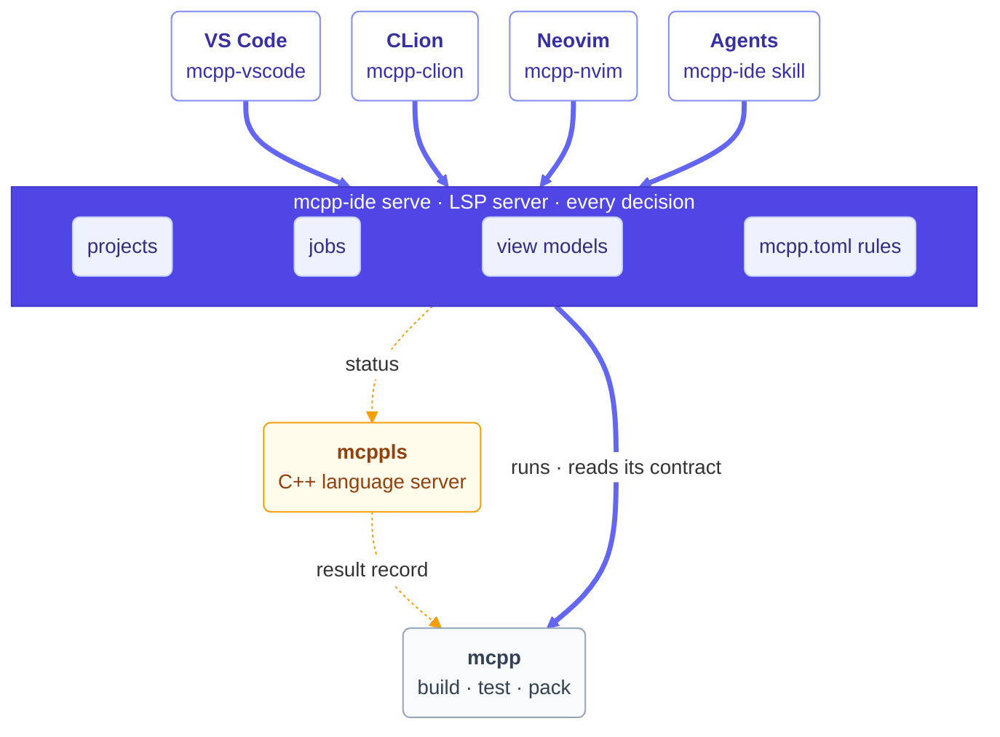

<div align="center">

# mcpp-ide

**One backend for every editor of [mcpp](https://github.com/mcpp-community/mcpp) projects**

VS Code · CLion · Neovim build, run, test, debug and pack alike

[](https://github.com/mcpp-community/mcpp-ide/releases)
[](https://github.com/mcpp-community/mcpp-ide/actions/workflows/ci.yml)
[](https://marketplace.visualstudio.com/items?itemName=mcpp-community.mcpp-vscode)
[](https://open-vsx.org/extension/mcpp-community/mcpp-vscode)
[](https://plugins.jetbrains.com/plugin/35632-mcpp)
[](https://en.cppreference.com/w/cpp/23)
[](LICENSE)

**English** | [简体中文](README.zh-CN.md)

[Documentation](docs/README.md) · [Architecture](docs/architecture.md) · [Protocol](protocol/protocol.schema.json) ·
[For agents](agents/README.md) · [Contributing](AGENTS.md) · [Releases](https://github.com/mcpp-community/mcpp-ide/releases)

</div>

An editor integration of a build tool makes many decisions: which command a build runs, what a test
result means, how dangerous a cleanup is. If each editor makes them separately, the editors drift
apart. mcpp-ide makes them once. Its backend, `mcpp-ide serve`, reads only mcpp's machine contract
and answers every editor as an LSP server. Each plugin then shows those answers in its editor's own UI.



## Highlights

- **One answer everywhere**: what a build runs, how a test is reported and what a cleanup costs are decided by the backend
- **Only mcpp's contract**: no manifest parsing and no dependency resolution of its own
- **Tests as mcpp states them**: programs, cases, live results, diffs, metrics and Test Insights
- **Jobs in order**: one build at a time per project, a newer build replaces a waiting one, and cancelling ends cleanly
- **Safe cleanups**: each plan has a danger level, a preview and the confirmation that level requires

## Editors

| | VS Code 1.91+ | CLion 2026.1+ | Neovim 0.10+ |
|---|---|---|---|
| **Install** | [Marketplace](https://marketplace.visualstudio.com/items?itemName=mcpp-community.mcpp-vscode) · [Open VSX](https://open-vsx.org/extension/mcpp-community/mcpp-vscode) | [JetBrains Marketplace](https://plugins.jetbrains.com/plugin/35632-mcpp) | `xlings install mcpp-ide-nvim` |
| **Build · run · test** | tasks, Testing view | run configurations, test runner | `:Mcpp`, quickfix |
| **Debug** | CodeLLDB · C/C++ · lldb-dap | GDB · LLDB | nvim-dap |
| **Views** | libraries, graphs, cache, settings | native trees, forms, JCEF graphs | floating windows |
| **C++ (mcppls)** | [installed with it](https://marketplace.visualstudio.com/items?itemName=sunrisepeak.mcpp-language-server) | [mcppls plugin](https://plugins.jetbrains.com/plugin/35609) | `xlings install mcppls-nvim` |
| **Guide** | [mcpp-vscode](mide-plugins/vscode/README.md) | [mcpp-clion](mide-plugins/clion/README.md) | [mcpp-nvim](mide-plugins/nvim/README.md) |

mcpp.toml and build.mcpp get completion, hover, jumps and diagnostics in every editor. The VS Code and
CLion packages carry the backend for Linux x64/arm64, macOS arm64 and Windows x64; offline, install the
`.vsix` or `.zip` from [Releases](https://github.com/mcpp-community/mcpp-ide/releases). Agents and other clients use `xlings install mcpp-ide`, then
`mcpp-ide serve`. Verify any install with `mcpp-ide self-check`; versions: [docs/versions.md](docs/versions.md).

## With an agent

Paste this into any coding agent. It reads only what your task needs, and asks you first when the
task is not clear.

```text
Work with mcpp-ide (https://github.com/mcpp-community/mcpp-ide), the IDE layer of mcpp.
Read AGENTS.md first, then only what my task needs:
- install or use it: agents/README.md, verified with `mcpp-ide self-check` on my project
- understand it: docs/architecture.md, saying which layer owns what
- report a bug or propose a feature: .agents/skills/mcpp-ide-contributing, triage first
  (mcpp, mcppls, backend or one plugin; fix or workaround), then draft the issue from its template
- change the code: that skill and .agents/skills/mcpp-ide-development, with tests that prove it
My task: <describe it, or leave it empty>
If it is empty or unclear, tell me in three lines what mcpp-ide is, then ask which of the above
I want, with one suggested first step for each. Ask me before opening an issue or a pull request,
pushing, or tagging.
```

## Development

```bash
mcpp build && mcpp test                                      # the backend, its mocks and mcpp-ide-dev
(cd mide-plugins/vscode && npm ci && npm test)               # VS Code, the parity gates included
(cd mide-plugins/clion && gradle buildPlugin verifyPlugin)   # CLion (xlings install gradle)
nvim --headless --clean -l mide-plugins/nvim/tests/smoke.lua # Neovim
```

The environment, the tests for each component, common changes and the release procedure are in the
[development skill](.agents/skills/mcpp-ide-development/SKILL.md).

## Contributing

Every change starts with an issue ([templates](https://github.com/mcpp-community/mcpp-ide/issues/new/choose))
and goes through a pull request. The rules are in [AGENTS.md](AGENTS.md): who owns what, how to
triage (core or plugin, fix or workaround), versions and code. The procedure for people and agents
is in the [contributing skill](.agents/skills/mcpp-ide-contributing/SKILL.md). Questions go to the
[forum](https://forum.d2learn.org/category/20).

## License

[Apache-2.0](LICENSE)
