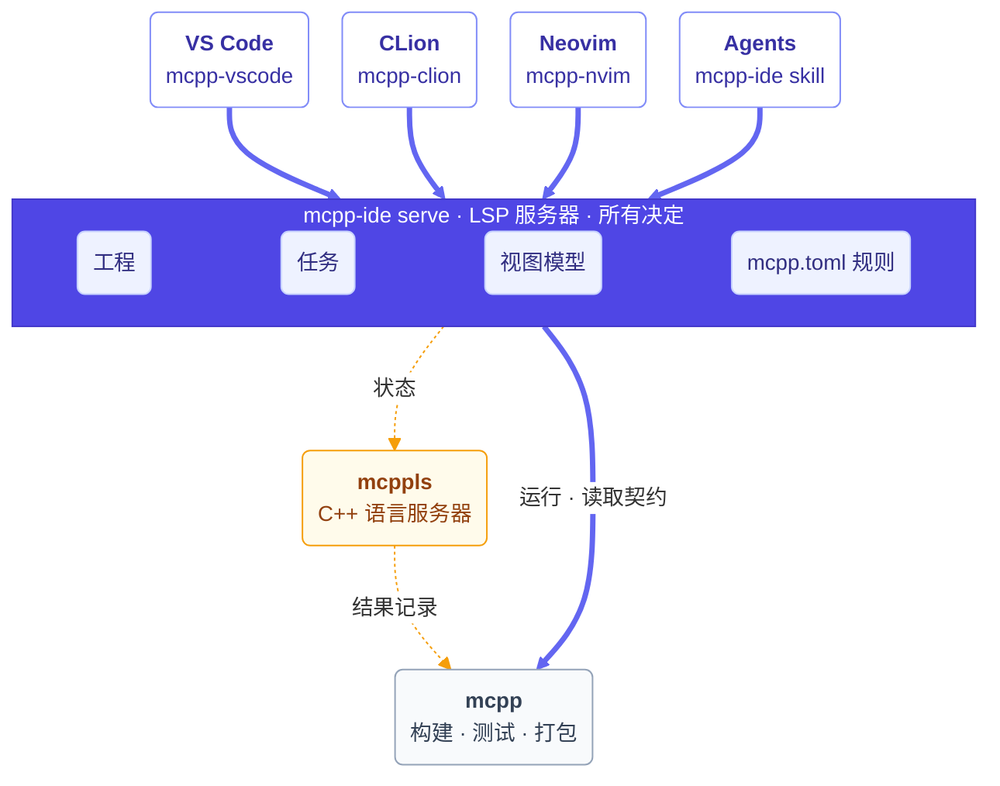

<div align="center">

# mcpp-ide

**所有编辑器共用一个后端来对待 [mcpp](https://github.com/mcpp-community/mcpp) 工程**

VS Code · CLion · Neovim 的构建、运行、测试、调试、打包行为一致

[](https://github.com/mcpp-community/mcpp-ide/releases)
[](https://github.com/mcpp-community/mcpp-ide/actions/workflows/ci.yml)
[](https://marketplace.visualstudio.com/items?itemName=mcpp-community.mcpp-vscode)
[](https://open-vsx.org/extension/mcpp-community/mcpp-vscode)
[](https://plugins.jetbrains.com/plugin/35632-mcpp)
[](https://en.cppreference.com/w/cpp/23)
[](LICENSE)

[English](README.md) | **简体中文**

[文档](docs/README.md) · [架构](docs/architecture.md) · [协议](protocol/protocol.schema.json) ·
[面向 Agent](agents/README.md) · [贡献](AGENTS.md) · [发布](https://github.com/mcpp-community/mcpp-ide/releases)

</div>

构建工具的编辑器集成要做许多决定：构建运行哪条命令、测试结果是什么含义、一次清理有多危险。每个编辑器各写一遍，
这些决定就会分歧。mcpp-ide 只做一次：后端 `mcpp-ide serve` 只读取 mcpp 的机器契约，以 LSP 服务器回答所有编辑器，
各插件再用编辑器自己的界面呈现这些回答。



## 特性

- **处处同一答案**：构建运行什么、测试如何报告、清理的代价，都由后端决定
- **只读 mcpp 的契约**：不自行解析清单，不自行解析依赖
- **测试即 mcpp 所述**：程序、用例、实时结果、差异对比、指标与 Test Insights
- **任务有序**：每个工程同一时间一个构建，新构建替换等待中的构建，取消会正常结束
- **安全清理**：每个计划都带危险等级与预览，并按该等级要求确认

## 编辑器

| | VS Code 1.91+ | CLion 2026.1+ | Neovim 0.10+ |
|---|---|---|---|
| **安装** | [Marketplace](https://marketplace.visualstudio.com/items?itemName=mcpp-community.mcpp-vscode) · [Open VSX](https://open-vsx.org/extension/mcpp-community/mcpp-vscode) | [JetBrains Marketplace](https://plugins.jetbrains.com/plugin/35632-mcpp) | `xlings install mcpp-ide-nvim` |
| **构建 · 运行 · 测试** | 任务、测试视图 | 运行配置、测试运行器 | `:Mcpp`、quickfix |
| **调试** | CodeLLDB · C/C++ · lldb-dap | GDB · LLDB | nvim-dap |
| **视图** | 库、依赖图、缓存、设置 | 原生树、表单、JCEF 图 | 浮动窗口 |
| **C++（mcppls）** | [随扩展安装](https://marketplace.visualstudio.com/items?itemName=sunrisepeak.mcpp-language-server) | [mcppls 插件](https://plugins.jetbrains.com/plugin/35609) | `xlings install mcppls-nvim` |
| **指南** | [mcpp-vscode](mide-plugins/vscode/README.zh-CN.md) | [mcpp-clion](mide-plugins/clion/README.md) | [mcpp-nvim](mide-plugins/nvim/README.md) |

mcpp.toml 与 build.mcpp 在所有编辑器中都有补全、悬停、跳转与诊断。VS Code 与 CLion 的包自带后端，覆盖
Linux x64/arm64、macOS arm64 与 Windows x64；离线时从[发布页](https://github.com/mcpp-community/mcpp-ide/releases)安装 `.vsix` 或 `.zip`。Agent 与其他
客户端使用 `xlings install mcpp-ide`，然后运行 `mcpp-ide serve`。安装后用 `mcpp-ide self-check` 验证；版本见
[docs/versions.md](docs/versions.md)。

## 使用 Agent

把下面这段粘贴给任意编程 Agent。它只读任务需要的文档；任务不明确时，会先询问你。

```text
协助我处理 mcpp-ide（https://github.com/mcpp-community/mcpp-ide），即 mcpp 的 IDE 层。
先读 AGENTS.md，再只读我的任务需要的文档：
- 安装或使用：agents/README.md，并在我的工程上用 `mcpp-ide self-check` 验证
- 了解项目：docs/architecture.md，说明各层分别负责什么
- 报告问题或提出功能：.agents/skills/mcpp-ide-contributing，先分诊（mcpp、mcppls、后端还是某个插件；
  修复还是 workaround），再按模板起草 issue
- 修改代码：上述 skill 与 .agents/skills/mcpp-ide-development，并给出能证明改动的测试
我的任务：<在此描述，或留空>
若留空或不明确，先用三行说明 mcpp-ide 是什么，再问我想做上面哪一项，并为每项给出建议的第一步。
开 issue、PR，推送或打 tag 之前先征得我的同意。
```

## 开发

```bash
mcpp build && mcpp test                                      # 后端、mock 与 mcpp-ide-dev
(cd mide-plugins/vscode && npm ci && npm test)               # VS Code，含 parity 门禁
(cd mide-plugins/clion && gradle buildPlugin verifyPlugin)   # CLion（xlings install gradle）
nvim --headless --clean -l mide-plugins/nvim/tests/smoke.lua # Neovim
```

环境、各组件的测试、常见改动与发布流程见[开发 skill](.agents/skills/mcpp-ide-development/SKILL.md)。

## 参与贡献

每个改动都从 issue 开始（[模板](https://github.com/mcpp-community/mcpp-ide/issues/new/choose)），并通过 PR 合入。
规则见 [AGENTS.md](AGENTS.md)：谁负责什么、如何分诊（core 还是插件，修复还是 workaround）、版本与代码规范。
面向人与 Agent 的完整流程见[贡献 skill](.agents/skills/mcpp-ide-contributing/SKILL.md)。问题与讨论请到
[论坛](https://forum.d2learn.org/category/20)。

## 许可证

[Apache-2.0](LICENSE)
