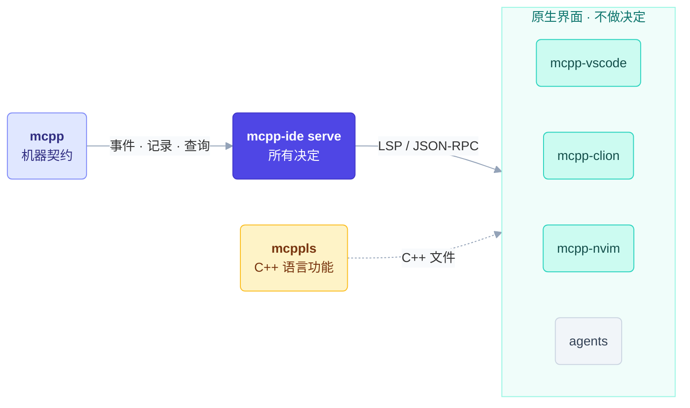

<div align="center">

# mcpp-ide

**所有编辑器共用一个后端来对待 [mcpp](https://github.com/mcpp-community/mcpp) 工程**

VS Code · CLion · Neovim 的构建、运行、测试、调试、打包行为一致

[](https://github.com/mcpp-community/mcpp-ide/releases)
[](https://github.com/mcpp-community/mcpp-ide/actions/workflows/ci.yml)
[](https://marketplace.visualstudio.com/items?itemName=mcpp-community.mcpp-vscode)
[](https://open-vsx.org/extension/mcpp-community/mcpp-vscode)
[](https://plugins.jetbrains.com/plugin/io.github.mcpp-community.mcpp-clion)
[](https://en.cppreference.com/w/cpp/23)
[](LICENSE)

[English](README.md) | **简体中文**

[文档](docs/README.md) · [架构](docs/architecture.md) · [协议](protocol/protocol.schema.json) ·
[面向 Agent](agents/README.md) · [贡献](AGENTS.md) · [发布](https://github.com/mcpp-community/mcpp-ide/releases)

</div>

构建工具的编辑器集成要做许多决定：构建运行哪条命令、测试结果是什么含义、一次清理有多危险。每个编辑器各写一遍，
这些决定就会分歧。mcpp-ide 只做一次：后端 `mcpp-ide serve` 只读取 mcpp 的机器契约，以 LSP 服务器回答所有编辑器，
各插件再用编辑器自己的界面呈现这些回答。



## 特性

- **处处同一答案**：构建运行什么、测试如何报告、清理的代价，都由后端决定
- **只读 mcpp 的契约**：不自行解析清单，不自行解析依赖
- **测试即 mcpp 所述**：程序、用例、实时结果、差异对比、指标与 Test Insights
- **任务有序**：每个工程同一时间一个构建，新构建替换等待中的构建，取消会正常结束
- **安全清理**：每个计划都带危险等级与预览，并按该等级要求确认

## 编辑器

| | VS Code | CLion | Neovim |
|---|---|---|---|
| 构建、运行、测试 | 任务、测试视图 | 运行配置、测试运行器、`main` 旁的 ▶ | `:Mcpp`、缓冲区、quickfix |
| 调试 | CodeLLDB、C/C++、lldb-dap | CLion 的 GDB / LLDB | nvim-dap |
| mcpp.toml、build.mcpp | 补全、悬停、跳转、诊断 | 同上 | 同上，经 `vim.lsp` |
| 库、依赖图、缓存、设置 | 视图与页面 | 原生树、表单、JCEF 中的图 | 浮动窗口、`vim.ui.select` |
| C++ 语言功能 | mcppls（扩展包） | mcppls CLion 插件 | mcppls-nvim |
| 详情 | [mcpp-vscode](mide-plugins/vscode/README.zh-CN.md) | [mcpp-clion](mide-plugins/clion/README.md) | [mcpp-nvim](mide-plugins/nvim/README.md) |

## 安装

| 编辑器 | 安装 |
|---|---|
| VS Code 1.91+ | Marketplace 或 Open VSX：`mcpp-community.mcpp-vscode`，或 `code --install-extension mcpp-vscode-<version>.vsix` |
| CLion 2026.1+ | JetBrains Marketplace：`mcpp-clion`，依赖 mcppls CLion 插件；或从磁盘安装 ZIP |
| Neovim 0.10+ | `xlings install mcpp-ide-nvim`（连同后端，启动时自动 setup）与 `xlings install mcppls-nvim` |
| Agent、其他客户端 | `xlings install mcpp-ide`，然后运行 `mcpp-ide serve`；或 `okrun mcpp-ide-<version>.okb serve` |

VS Code 与 CLion 的包自带后端，覆盖 Linux x64/arm64、macOS arm64 与 Windows x64
（[分发方式](docs/architecture.md#distribution)）。在工程中运行 `mcpp-ide self-check` 即可验证安装。
版本与 mcpp 的兼容性见 [docs/versions.md](docs/versions.md)。

## 使用 Agent

一条提示词写清四件事：**仓库**、**先读哪份文档**、**要做的任务**、**以什么检查结束**。文档本身面向 Agent 编写，
所以提示词可以很短。复制一条，填入 `<...>` 即可。

**安装** · [agents/README.md](agents/README.md)、[mcpp-ide skill](agents/skills/mcpp-ide/SKILL.md)

```text
阅读 https://github.com/mcpp-community/mcpp-ide 的 agents/README.md，为 <我的编辑器> 从最新发布安装
mcpp-ide，并在我的工程上用 `mcpp-ide self-check` 验证。
```

**了解项目** · [AGENTS.md](AGENTS.md)、[docs/architecture.md](docs/architecture.md)

```text
阅读 https://github.com/mcpp-community/mcpp-ide 的 AGENTS.md 与 docs/architecture.md，说明一次构建如何
从编辑器经后端到达 mcpp，以及 <功能> 属于哪一层。
```

**参与贡献** · [贡献](.agents/skills/mcpp-ide-contributing/SKILL.md)与[开发](.agents/skills/mcpp-ide-development/SKILL.md) skill

```text
阅读 https://github.com/mcpp-community/mcpp-ide 的 AGENTS.md 与 .agents/skills/mcpp-ide-contributing，
对 <issue> 做分诊（core 还是插件，修复还是 workaround），提出改动方案及能证明它的测试；开 PR 前先等我确认。
```

## 开发

```bash
mcpp build && mcpp test                                      # 后端、mock 与 mcpp-ide-dev
(cd mide-plugins/vscode && npm ci && npm test)               # VS Code，含 parity 门禁
(cd mide-plugins/clion && gradle buildPlugin verifyPlugin)   # CLion（xlings install gradle）
nvim --headless --clean -l mide-plugins/nvim/tests/smoke.lua # Neovim
```

环境、各组件的测试、常见改动与发布流程见[开发 skill](.agents/skills/mcpp-ide-development/SKILL.md)。

## 参与贡献

每个改动都从 issue 开始（[模板](https://github.com/mcpp-community/mcpp-ide/issues/new/choose)），并通过 PR 合入。
规则见 [AGENTS.md](AGENTS.md)：谁负责什么、如何分诊（core 还是插件，修复还是 workaround）、版本与代码规范。
面向人与 Agent 的完整流程见[贡献 skill](.agents/skills/mcpp-ide-contributing/SKILL.md)。问题与讨论请到
[论坛](https://forum.d2learn.org/category/20)。

## 许可证

[Apache-2.0](LICENSE)
