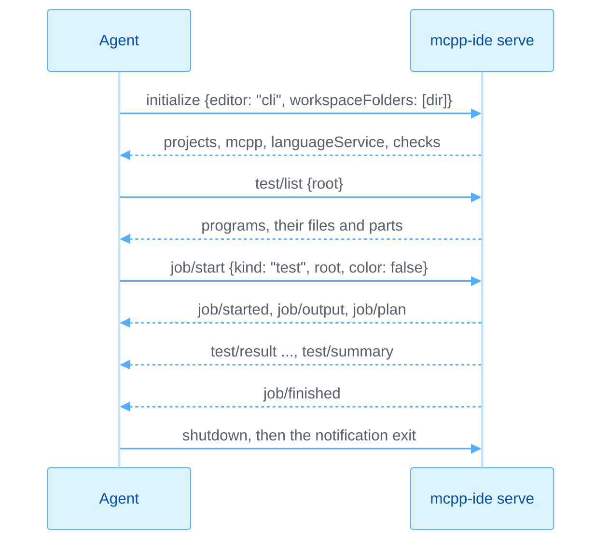

# mcpp-ide for agents

An agent drives an mcpp project the way the editors do: through the mcpp-ide backend, whose
protocol is JSON-RPC on the standard streams of `mcpp-ide serve`
([protocol/protocol.schema.json](../protocol/protocol.schema.json)). The backend answers the same
questions the panels ask -- which tests a project has, what a cleanup would remove, which platform
configures a target -- from mcpp's machine contract, so an agent and a person in the editor see the
same facts.

An agent that only builds and tests needs none of this: `mcpp build --message-format json` and
`mcpp test --message-format json` are mcpp's own contract (mcpp docs/50, docs/52). The backend is
for what mcpp leaves to its clients: one job at a time per project, cleanup plans with their
danger levels, views of the cache, the libraries and the graphs, and the language service's state.

## Getting the backend

- `xlings install mcpp-ide`, or
- from a clone: `mcpp build`, then `target/<triple>/<fingerprint>/bin/mcpp-ide`.

`mcpp-ide self-check` (or `self-check --json`) reports what the backend finds: the backend, mcpp
and its contract, mcppls, xlings, trust.

## A session

Each message is framed as in LSP: `Content-Length: <n>\r\n\r\n<json>`.

## The skill

[skills/mcpp-ide/SKILL.md](skills/mcpp-ide/SKILL.md) is a skill for agents that load skills
(Claude Code and others): when to use the backend, the methods worth knowing, and how to read the
answers.
